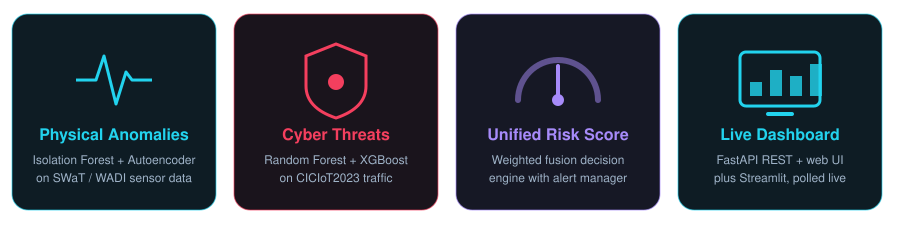
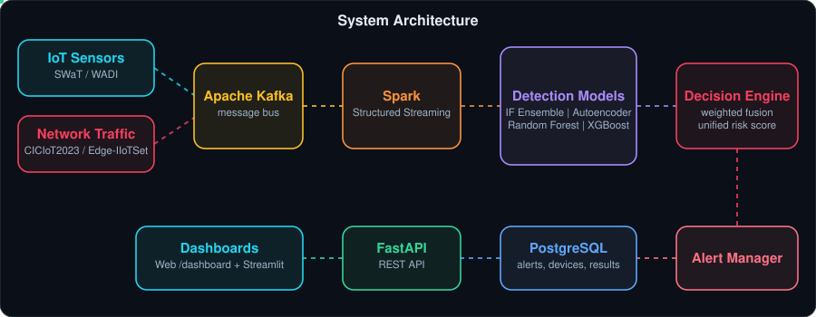
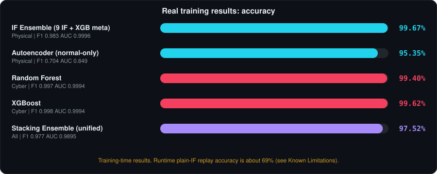
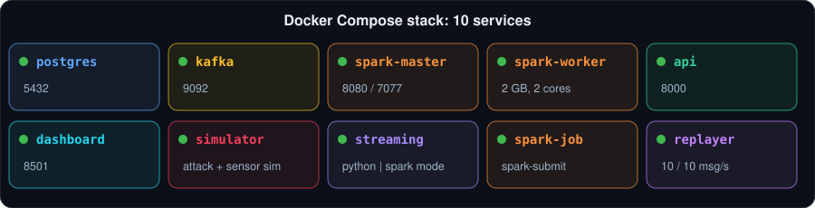

<div align="center">




</div>


<div align="center">

</div>


A production-style IoT cybersecurity platform (final-year project) that detects **two threat classes in real time**:

1. **Physical sensor anomalies:** an Isolation Forest ensemble and an Autoencoder trained on SWaT / WADI process data.
2. **Cyber and network threats:** Random Forest and XGBoost trained on CICIoT2023 network traffic.

Both feed a **unified risk-scoring decision engine**. Results are stored in **PostgreSQL**, exposed through a **FastAPI REST API** and a **live dark-themed web dashboard**, all streamed through **Apache Kafka** and processed by **Apache Spark Structured Streaming**.

> **Principle followed throughout: never fabricate metrics.** Every number in this README is a real training or verification output, including the negative results listed under [Known Limitations](#-known-limitations).

- **Package:** `iot-cyber-physical-security` v1.0.0 (MIT)
- **CLI:** `iot-sec` with 9 subcommands
- **Dashboards:** web (`/dashboard`) and Streamlit


<div align="center">

</div>

<div align="center">

</div>


<div align="center">

</div>


<div align="center">

</div>


<div align="center">

</div>

<div align="center">

</div>


<div align="center">

</div>


<div align="center">

</div>

<details>
<summary><b>Text version of the data flow</b></summary>

```text
IoT Sensors (SWaT/WADI)                    --> Apache Kafka --> Spark Structured Streaming
Network Traffic (CICIoT2023/Edge-IIoTSet)  -->                        |
                                                                      v
                                              Detection Models: IF Ensemble, Autoencoder,
                                                                Random Forest, XGBoost
                                                                      |
                                                                      v
                                              Decision Engine (weighted fusion -> unified risk score)
                                                                      |
                                              Alert Manager -> PostgreSQL
                                                                      |
                                              FastAPI REST + Web Dashboard (/dashboard) + Streamlit (8501)
```

</details>

**Streaming modes:** Python mode is the default (`STREAMING_MODE=python`). Spark mode is available through `scripts/start_streaming.py`. If the Isolation Forest is unavailable, the processor falls back to a z-score detector and logs it.


<div align="center">

</div>


<div align="center">

</div>

All numbers are actual outputs of training runs, stored as JSON in `experiments/results/`.

| Model | Domain | Dataset | Accuracy | F1 | ROC-AUC |
|---|---|---|---|---|---|
| IF Ensemble (9 IF + XGBoost meta) | Physical | SWaT + WADI | **99.67%** | 0.983 | 0.9996 |
| Autoencoder (normal-only) | Physical | SWaT + WADI | **95.35%** | 0.704 | 0.849 |
| Random Forest | Cyber | CICIoT2023 | **99.40%** | 0.997 | 0.9994 |
| XGBoost | Cyber | CICIoT2023 | **99.62%** | 0.998 | 0.9994 |
| Edge-IIoTSet models (RF / XGB) | Cyber | Edge-IIoTSet | **100%** | n/a | n/a |
| Stacking Ensemble (unified) | All | All | **97.52%** | 0.977 | 0.9895 |
| Cross-dataset validation | n/a | train A, test B | n/a | n/a | **0.50** |

The cross-dataset result is an honest negative: the models do not generalize from one dataset to another.

Experiment write-up: [`experiments/RESULTS.md`](experiments/RESULTS.md). Figures (model comparison, autoencoder convergence, confusion matrices, dataset stats, architecture, ROC) are in `experiments/figures/`.

<details>
<summary><b>Verified inference chains</b></summary>

<br/>

**Physical anomaly (one row in):**

```python
from pathlib import Path
pre = PhysicalPreprocessor.load(Path("models/physical"))
model = IsolationForestModel.load(Path("models/physical/isolation_forest"))
preds, scores = model.predict(df)          # scores = -model.score_samples(df)
```

**Cyber threat (46-feature vector in):**

```python
import joblib
scaler = joblib.load("models/cyber/scaler.joblib")
rf = joblib.load("models/cyber/random_forest.joblib")   # xgboost.joblib also available
prob = rf.predict_proba(scaler.transform(vec_46))[0, 1]
```

</details>


<div align="center">

</div>


| Dataset | Type | Rows | Features | Source |
|---|---|---|---|---|
| SWaT | Physical | 1,441,719 | 51 | SUTD |
| WADI | Physical | 1,209,601 | 127 | SUTD |
| CICIoT2023 | Cyber | 7,570,414 | 46 | UNB CIC |
| Edge-IIoTSet | Cyber | 156,986 | 57 | AIMaster |

Total under `data/raw/` is about **5.2 GB** and is **not committed**. Loaders live in `src/datasets/`.

```bash
python scripts/download_datasets.py --synthetic --dataset all   # synthetic fallback
python scripts/download_datasets.py --help                      # real download instructions
```


<div align="center">

</div>


<div align="center">

</div>

<details>
<summary><b>Service details</b></summary>

<br/>

| Service | Image / Build | Ports | Purpose |
|---|---|---|---|
| postgres | `postgres:16-alpine` | 5432 | Database `iot_security`, with a healthcheck |
| kafka | `apache/kafka:3.7.0` | 9092 | KRaft single node; listeners `kafka:29092` (internal) and `localhost:9092` (external) |
| spark-master | `apache/spark:3.5.1` | 8080, 7077 | Spark master |
| spark-worker | `apache/spark:3.5.1` | n/a | 2 GB memory, 2 cores |
| api | `docker/Dockerfile.api` | 8000 | FastAPI and web dashboard |
| dashboard | `docker/Dockerfile.dashboard` | 8501 | Streamlit dashboard |
| simulator | `docker/Dockerfile.simulator` | n/a | Attack and sensor simulation into Kafka |
| streaming | `docker/Dockerfile.streaming` | n/a | Detection pipeline (`python` or `spark` mode) |
| spark-job | `docker/Dockerfile.spark` | n/a | `spark-submit` with the Kafka connector package |
| replayer | `docker/Dockerfile.replayer` | n/a | Replays dataset samples into Kafka |

Named volumes: `postgres_data`, `spark_data`, `spark_ivy`. All Dockerfiles build from the repository root.

</details>


<div align="center">

</div>

<div align="center">

</div>


```bash
git clone https://github.com/JDevender007/Real-Time-Anomaly-and-Cyber-Threat-Detection-for-IoT-Sensors-Using-Apache-Kafka-and-Apache-Spark.git
cd Real-Time-Anomaly-and-Cyber-Threat-Detection-for-IoT-Sensors-Using-Apache-Kafka-and-Apache-Spark
```

> ⚠️ **Datasets (about 5.2 GB) and trained model binaries are not in this repository.** GitHub rejects files over 100 MB, and the largest model is 334 MB. A fresh clone needs `scripts/download_datasets.py` and training before the full streaming stack runs.

### Full stack with Docker

```bash
docker compose up -d                                              # start all 10 services
docker compose restart simulator streaming replayer spark-job     # once Kafka is healthy
docker compose logs -f streaming                                  # watch the detection pipeline
docker compose up -d --build <service>                            # rebuild one service
docker compose down                                               # stop everything
```

### Local development (without Docker)

```bash
pip install -r requirements.txt
pip install -e ".[dev]"
uvicorn src.api.main:app --host 0.0.0.0 --port 8000   # API + web dashboard
streamlit run dashboard/app.py                         # Streamlit on 8501
python scripts/start_streaming.py                      # streaming pipeline
python scripts/start_simulator.py                      # simulator
```

### Train the models

```bash
python scripts/train_physical_500k.py       # physical anomaly models
python scripts/train_cyber_real.py          # cyber threat models
python scripts/train_stacking_ensemble.py   # unified stacking ensemble
```

<details>
<summary><b>Docker Desktop is unstable on low-RAM machines? Use this order</b></summary>

<br/>

1. Start Docker Desktop and wait until `docker info` reports healthy.
2. `docker compose up -d`
3. Once Kafka is healthy: `docker compose restart simulator streaming replayer spark-job`
4. If an image build fails with a pip DNS or hash error, retry the build. It is a network blip.

</details>


<div align="center">

</div>


| What | URL |
|---|---|
| **Web dashboard (dark theme)** | http://localhost:8000/dashboard |
| API interactive docs | http://localhost:8000/docs |
| Streamlit dashboard | http://localhost:8501 |
| Spark Master UI | http://localhost:8080 |
| Kafka (external) | `localhost:9092` |
| PostgreSQL | `localhost:5432` |

Protected endpoints use the `X-API-Key` header. The key is set through the `IOT_SEC_API_KEY` environment variable (see `docker-compose.yml` and `.env.example`). Change it before any real deployment.

| Endpoint | Method | Description |
|---|---|---|
| `/api/v1/health` | GET | Health check |
| `/dashboard` | GET | Web dashboard |
| `/api/v1/dashboard/health` | GET | Infra health: Postgres, Kafka, Spark master and worker, ML models |
| `/api/v1/dashboard/models` | GET | Model metric cards parsed from `experiments/results/` |
| `/api/v1/devices` and `/{id}` | GET | Device inventory |
| `/api/v1/alerts` | GET | Query alerts |
| `/api/v1/anomalies` | GET | Physical anomaly results |
| `/api/v1/threats` | GET | Cyber threat results |
| `/api/v1/metrics` | GET | System metrics |
| `/api/v1/models` | GET | Model training status |
| `/api/v1/statistics` | GET | Alert statistics |
| `/api/v1/simulation/*` | POST | Simulation control |


<div align="center">

</div>


```bash
iot-sec <command>              # or: python -m src.cli.main <command>
```

Commands: `train-physical`, `train-cyber`, `generate-data`, `instructions`, `evaluate`, `serve`, `dashboard`, `status`, `test`.


<div align="center">

</div>


```text
project-root/
├── configs/        # app, database, kafka, logging, models, risk, simulation, spark (YAML)
├── dashboard/      # Streamlit app + dark web dashboard served by FastAPI
├── docker/         # per-service Dockerfiles and requirements
├── docs/           # reference audit
├── experiments/    # RESULTS.md, figures/, results/ (real training JSON)
├── notebooks/      # 01_quick_start.ipynb
├── scripts/        # 30+ training, evaluation, replay, streaming and simulator scripts
├── src/            # 18 packages (below)
├── tests/          # unit / integration / performance
├── docker-compose.yml
├── Makefile
├── pyproject.toml
└── requirements.txt
```

<details>
<summary><b>The 18 packages in <code>src/</code></b></summary>

<br/>

| Package | Role |
|---|---|
| `api/` | FastAPI app, API-key auth, schemas, dashboard routes |
| `models/` | Isolation Forest, Autoencoder (PyTorch), Random Forest, XGBoost wrappers |
| `datasets/` | SWaT, WADI, CICIoT2023, Edge-IIoTSet loaders and registry |
| `preprocessing/` | Physical and cyber scalers and encoders |
| `features/` | Feature engineering (rolling, rate of change) |
| `streaming/` | Detection pipeline and Spark structured streaming |
| `kafka/` | Producer, consumer, serializers, topics |
| `database/` | SQLAlchemy models and repositories (PostgreSQL in Docker, SQLite locally) |
| `decision/` | Weighted-fusion risk scoring engine |
| `alerts/` | Alert manager |
| `simulation/` | IoT device and attack simulators |
| `monitoring/` | Performance tracking and drift detection |
| `explainability/` | SHAP TreeExplainer |
| `research/` | Cross-dataset validation, ablations, figures |
| `cli/` | The `iot-sec` command line |
| `config/` | Settings, YAML loader, logging |
| `utils/` | Exceptions, helpers, logger |
| `pipeline/` | Orchestrator |

</details>


<div align="center">

</div>


```bash
python -m pytest tests/ -v      # 138 tests
```

**138 / 138 passing.** The suite covers API endpoints, cyber and physical models, the database, datasets, streaming modules and processor, an integration pipeline test and performance benchmarks. Tests do not depend on model binaries or result files, so they run on a fresh clone.


<div align="center">

</div>


Reported honestly, as the project's principle requires.

1. **IF Ensemble accuracy (99.67%) is not what runs at inference.** The 9 base Isolation Forest models were not persisted; only the final single `isolation_forest.joblib` exists. Measured runtime replay accuracy with the plain Isolation Forest is about **69%**. Retraining to persist the 9 base models would fix this.
2. **Autoencoder runtime mismatch.** Loading the saved weights raises a BatchNorm architecture error. The code catches it and falls back gracefully. Autoencoder metrics also differ between result files (95.35% headline, 86.7% in `physical_combined_results.json`).
3. **No cross-dataset generalization.** Cross-dataset AUC is 0.50.
4. **Datasets and models are not in git.** See [Quick Start](#-quick-start).
5. **Docker Desktop can be unstable** on machines with about 15 GB RAM. Use the restart order above.

<details>
<summary><b>What was verified live</b></summary>

<br/>

- 10 containers running with green healthchecks.
- Streaming accuracy: physical about 69% (plain IF, see limitation 1), cyber about 99.8%, 0 errors.
- API serving 55,000+ alerts and 60 devices.
- Web dashboard returns HTTP 200; `/api/v1/dashboard/health` reported all services online and models loaded 2 of 3.
- Streamlit (8501) and the Spark UI (8080) respond.

</details>


<div align="center">

</div>


<div align="center">

**Devender J**
Final-year Computer Science Engineering student · Python Developer · AI and Cybersecurity enthusiast

<p>
  <a href="https://github.com/JDevender007"></a>
  <a href="https://www.linkedin.com/in/devender-j"></a>
</p>

Licensed under the MIT License.

</div>
